# Repeated Multilingual Translation: An Empirical Investigation of Convergence and Linguistic Dynamics

## Abstract

We investigate whether repeated translation through independently randomized language paths produces universal textual equality, weaker concentration, or persistent diversity. A completed experiment propagated 1,000 distinct FLORES English sentences through 100 rounds using NLLB-200 distilled 600M and a pool of 50 non-English languages. Diagnostic English observations were recorded at 24 rounds; they did not replace active trajectory states. We audited all archived runs, validated 100,000 main trajectory transitions and 24,000 English observations, and found no reconstruction discrepancies. At the final observation, 985 of 1,000 outputs were distinct. The largest exact group reached only 8 trajectories at any observation and contained 3 at the end. Exact collisions first appeared at round 30; their frequency was nonmonotone, and no universal or majority equality occurred. Most English-equal pair observations joined different pre-observation linguistic states. Some pairs remained equal across observed endpoints more often than under independent reassignment, but splitting and recurrence preclude an absorbing-state interpretation. Mean MiniLM similarity to the original declined from 1.000 to 0.127, while mean cross-trajectory cosine rose from 0.035 to 0.102. This modest embedding concentration coexisted with broad residual diversity; it did not establish semantic identity. Vocabulary and original-content proxies declined strongly. Recorded repetition and generation-limit warnings complicate interpretation, but excluding flagged outputs did not remove the main pattern of drift with diversity. The strongest empirical result is therefore not universal convergence: substantial alteration of original content coexists with mostly distinct outputs and small, partly transient collision groups. These finite, model-specific observations motivate questions about observation maps, nonabsorbing coalescence, and operator coupling, without establishing asymptotic convergence or a communication-channel information law.

## 1. Introduction

The motivating conjecture asks whether independently routed translations of initially different sentences could eventually produce the same sentence. This experiment tests observed finite-round consequences, not the infinite-time conjecture. We distinguish exact raw-string equality, equality under declared normalizations, embedding similarity, concentration of an empirical distribution, preservation of original content, and synchronization of realized trajectories. None is a substitute for the others.

We call an **observed collision** equality of two diagnostic English strings at the same observed round. **Active-state equality** instead requires the ordered pair (language code, exact text) to agree. **Endpoint persistence** means that a colliding pair is still equal at the next observation, without assuming equality at intervening rounds. “Candidate attractor” below labels an investigated recurring output only; it is not a claim about invariant sets, stationary distributions or limits.

## 2. Experimental setup

The main run selected 1,000 distinct English strings from FLORES-200 devtest with selection seed 1729. NLLB-200 distilled 600M, revision `f8d333a098d19b4fd9a8b18f94170487ad3f821d`, generated greedy float32 translations. Each sentence followed its own seeded sequence of shuffled 50-language permutations. Each language occurs twice per trajectory over 100 rounds; immediate repetitions at permutation boundaries are avoided. The 50-language pool excludes English. Complete settings, seeds, model hashes and schedules remain inside the archive; [the audit](data_audit.md) lists the languages and provenance.

Main observations occurred at rounds `[0, 1, 2, 3, 5, 10, 15, 20, 25, 30, 35, 40, 45, 50, 55, 60, 65, 70, 75, 80, 85, 90, 95, 100]`. Round zero is an exact copy of the original; the other 23 observations translate the current active text into English. Diagnostics never feed back into the active chain. The 100,000 active transitions plus 23,000 diagnostic calls give 123,000 main model invocations. The smaller pilot and smoke runs validate collection but do not supply independent repetitions of the main experiment. We analyze one main realization and do not pool those auxiliary runs into its population.

The collection imposed a 512-token input limit and a 256-new-token output limit. This makes the implemented transformation depend on tokenizer and decoding constraints, not solely on natural language. [Actual counts and quality flags](tables/data_quality_summary.csv).

## 3. Data integrity and validation

The archive's sidecar SHA-256, ZIP CRCs and all 717 manifest-listed file checksums passed. The audit independently followed all 1,000 main schedules through 101 checkpoints, checked every canonical record against its request and preceding state, verified journals and nested manifests, and reconciled model-call totals. No missing expected observations, malformed records, duplicate canonical identifiers, empty outputs, explicit failures or inactive final trajectories were found. The 24,000 main English observations are actual measurements/copies; nothing is interpolated at unobserved rounds. [Detailed audit](data_audit.md).

All main outputs were accepted as `ok`, yet 6,511 records reached the generation-token limit and 6,740 carried repetition warnings, with overlap. Structural validity is therefore not a judgment of translation fidelity. We retain them in primary analyses and label sensitivity filters explicitly. No data were repaired, retranslated or overwritten.

## 4. Exact textual convergence

For observed round t, let Nₜ be the valid population, nᵢ the group sizes and pᵢ=nᵢ/Nₜ. We report D(t), the number of distinct raw Unicode strings, and the probability of equality for two distinct uniformly selected trajectories:

$$P_{\mathrm{collision}}(t)=\frac{\sum_i n_i(n_i-1)}{N_t(N_t-1)}.$$

Entropy is H(t)=−Σᵢpᵢ log pᵢ in nats, with exp(H) and 1/Σᵢpᵢ² as effective diversities. These describe output-label frequencies. They are not the mutual information of an input-output channel: each original has only one realized randomized path, without repeated conditional samples.

| round | valid_n | distinct | collision_pairs | largest_size | entropy_nats | effective_shannon | effective_simpson |
|---|---|---|---|---|---|---|---|
| 0 | 1000 | 1000 | 0 | 1 | 6.90776 | 1000 | 1000 |
| 25 | 1000 | 1000 | 0 | 1 | 6.90776 | 1000 | 1000 |
| 50 | 1000 | 998 | 2 | 2 | 6.90498 | 997.231 | 996.016 |
| 75 | 1000 | 990 | 17 | 5 | 6.89087 | 983.254 | 967.118 |
| 90 | 1000 | 984 | 40 | 8 | 6.87726 | 969.962 | 925.926 |
| 100 | 1000 | 985 | 18 | 3 | 6.88539 | 977.884 | 965.251 |

Source: [round-level metrics](tables/round_level_metrics.csv). All displayed denominators are 1,000. The final D is 985; the minimum is 984. The first observed nonsingleton group appears at round 30. There are 2 intervals with increasing distinct count, so diversity is not monotone. No observation reached universal equality, a majority, or any of the prespecified 10%, 25%, 50%, 75% or 90% largest-group thresholds.

The largest group ever had 8 members (0.8%) at round 90; the final largest group has 3 (0.3%). The final equal-pair count is 18 out of 499,500, giving 0.00003604; the maximum probability is 0.00008008. There is a small amount of partial equality, not macroscopic concentration. 973 outputs at the final observation are singletons, and the remaining collision groups contain only two or three trajectories. The frequency profiles provide no basis for a fitted heavy-tail law or a dominant output.


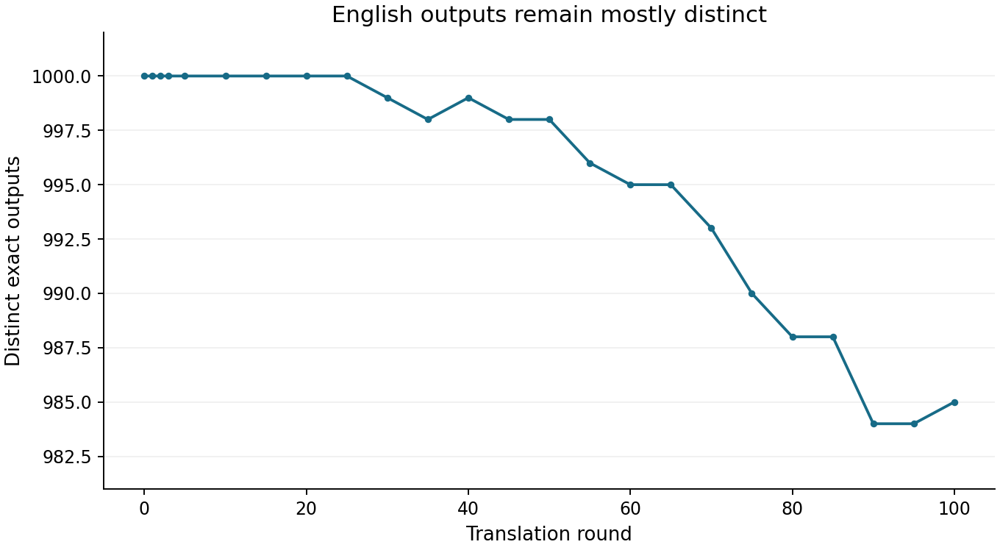

*Figure 1. Exact raw-string diversity at the 24 observed rounds. The vertical axis is restricted to make small changes visible; 1,000 trajectories were observed each time.*

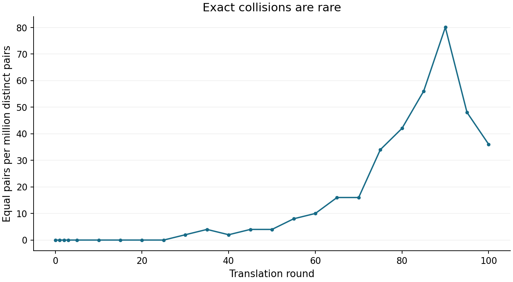

*Figure 2. Unordered equal-output pairs divided by N(N−1)/2, scaled to one million pairs. Pair comparisons are not independent experimental replicates.*

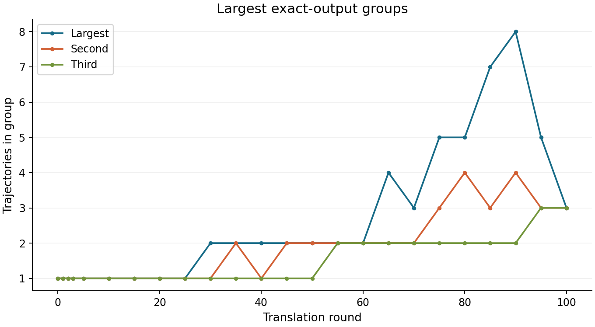

*Figure 3. Largest three group sizes at each observation. Ranks can refer to different sentences and members at different rounds; ties use lexical string order.*

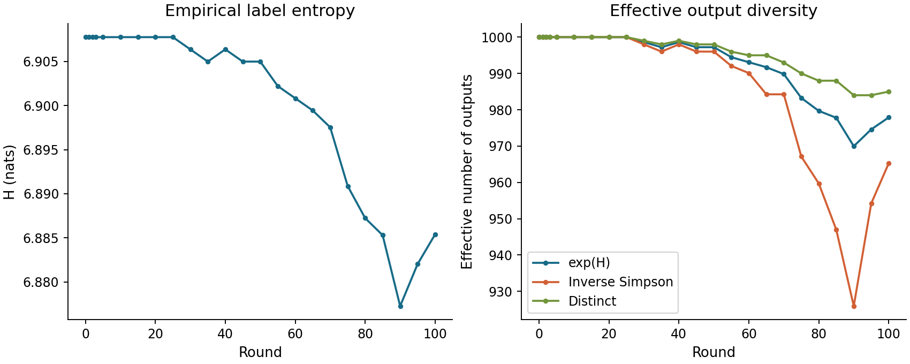

*Figure 4. Entropy of empirical English output labels and Hill diversity numbers. These are not estimates of retained information about the original sentence.*

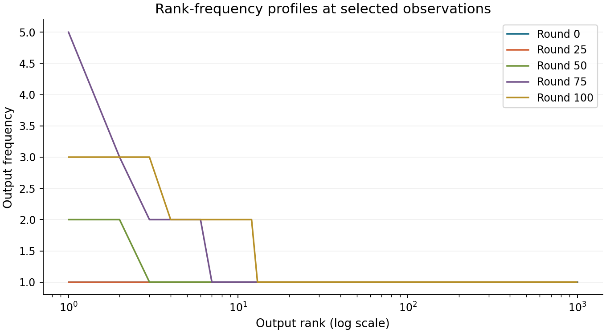

*Figure 5. Empirical rank-frequency profiles, dominated by singleton outputs. A logarithmic rank axis exposes the few repeated outputs; no power-law model is fitted.*

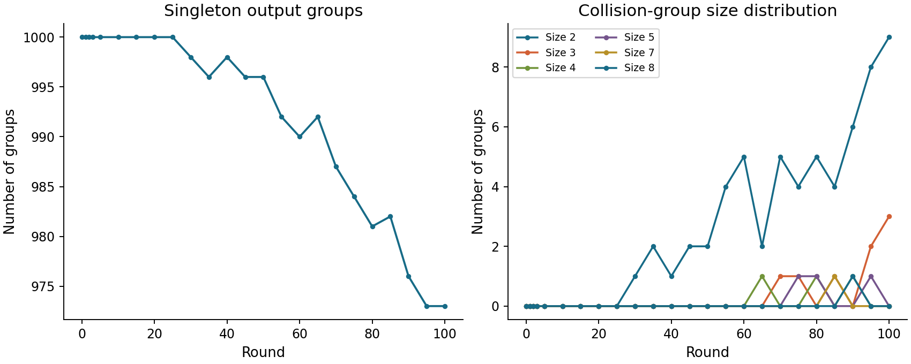

*Figure 6. Singleton counts and counts of each nonsingleton group size, separated to avoid hiding the small collision groups.*


### Normalization sensitivity

Raw Unicode strings are primary. NFC composes canonically equivalent characters; the next scheme collapses Unicode whitespace and strips boundary whitespace; the next case-folds; the most permissive replaces all Unicode punctuation-category characters with spaces and collapses whitespace again. Symbols are retained. These are deterministic label maps, not semantic judgments. Raw strings remain unchanged in all source records.

| normalization | distinct | collision_pairs | largest_size |
|---|---|---|---|
| raw | 985 | 18 | 3 |
| nfc | 985 | 18 | 3 |
| whitespace | 985 | 18 | 3 |
| casefold | 985 | 18 | 3 |
| punctuation | 975 | 32 | 4 |

Source: [normalization metrics](tables/round_level_metrics.csv). At the final observation, only punctuation removal changes these totals substantially, and even it leaves 975 distinct strings. [Examples of normalization collisions](examples/normalization_examples.json) show the concrete variants. No normalization yields universal equality.


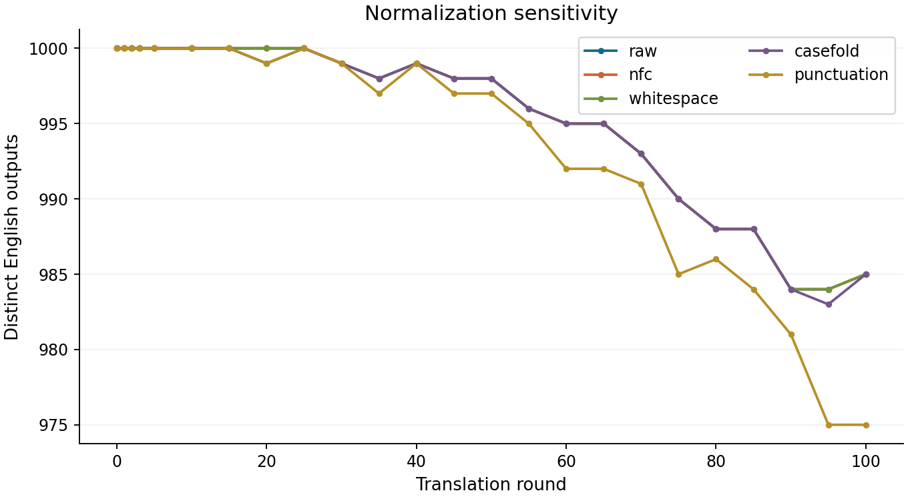

*Figure 7. Raw Unicode, NFC, collapsed whitespace, case folding, and punctuation-to-space comparisons. Normalization-induced equality is not semantic equivalence.*


## 5. Temporal dynamics

Partitions are compared on shared valid trajectory IDs at successive observed rounds. An equal pair persists if its two members are equal again, even if their common sentence changes. A split occurs when an old nonsingleton group has members in multiple next groups; a merge occurs when a new nonsingleton group draws from multiple previous groups. Largest-group identity is not presumed persistent; tied largest groups use a deterministic lexical tie break.

Across eligible intervals there are 163 prior equal-pair opportunities and 66 retained pair events, giving a descriptive pooled persistence fraction of 40.491%. These sums can count the same pair repeatedly; they are not independent Bernoulli trials. Across all observations, 95 distinct pairs ever collide, and 18 collide again after an intervening observed separation. Thus both memory and disruption occur. [Persistence](tables/collision_persistence.csv), [pair recurrence](tables/collision_pair_recurrence.csv), [group transitions](tables/group_transitions.csv).

The conditional null fixes both observed partitions' group sizes and randomly reassigns next-round group membership over shared IDs. It preserves concentration at each endpoint while destroying cross-time alignment of trajectory identities. The expectation for persistence is the next partition's collision probability. We use 999 permutations per eligible interval, seed 20261015, plus-one Monte Carlo p-values and Holm correction across intervals with previous collisions. Several observed persistence fractions exceed this very small null expectation. This demonstrates conditional membership dependence, not a causal effect of translation or evidence for the frequency distribution itself. Very few colliding pairs underpin some intervals, and the minimum attainable unadjusted Monte Carlo p-value is 0.001.

Most eligible intervals span five translations. Persistence at endpoints cannot establish uninterrupted equality inside the gap. Distinct future schedules can separate equal English projections; they can also separate identical active linguistic states. A collision is not an absorbing state under independently chosen future operators.


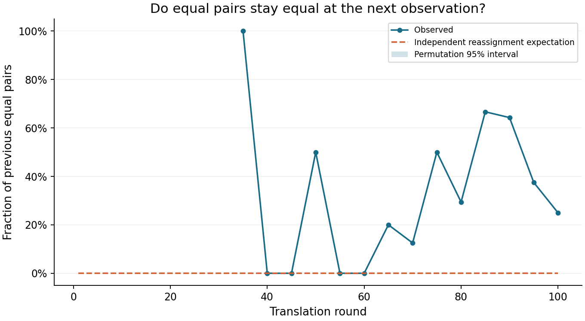

*Figure 10. Pair persistence across successive observed endpoints. Intervals are 1, 1, 1, 2, then 5 rounds; undefined values when no previous collisions exist are left blank. Shading is a conditional null interval, not a confidence interval.*

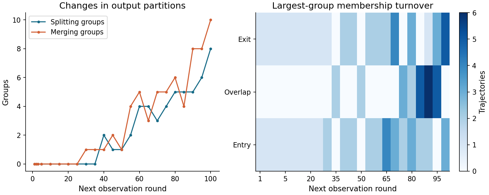

*Figure 11. Merge/split counts and turnover between the largest groups at successive observations. Tied largest groups are selected lexicographically; the heatmap does not imply a single persistent dominant sentence.*


## 6. English projection effects

Active labels include both language and exact text. Across all checkpoints active diversity reaches a minimum of 997; it is 999 at round 100. The English observation space differs because it suppresses language identity and performs another translation. Comparing its distinct count with active distinct count describes two representations, not a common-state convergence rate.

At the final observation, 17 of 18 English-equal pairs (94.44%) had different active states. Across all observed rounds, this applies to 172 of 181 equal-pair observations (95.03%); repeated pairs are counted again when observed again. These are operationally projection-induced collisions. Different active states may express similar content, so this breakdown is not proof that the observer fabricated a semantic coincidence or a causal estimate of observation bias. It does show that English equality usually does **not** establish equality of the actual state. [Projection metrics](tables/projection_collision_metrics.csv), [raw examples](examples/projection_examples.json).


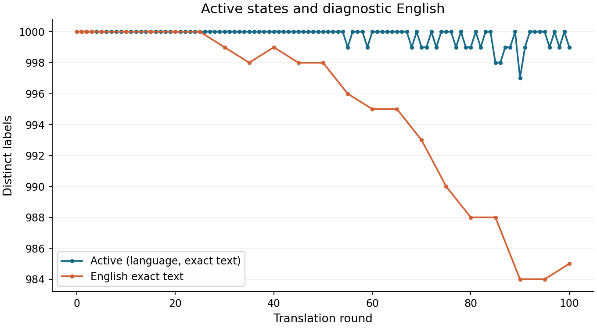

*Figure 8. Active linguistic states use both language and raw text and are available at all 101 checkpoints. English observations use a different representation space at only the displayed observation rounds.*

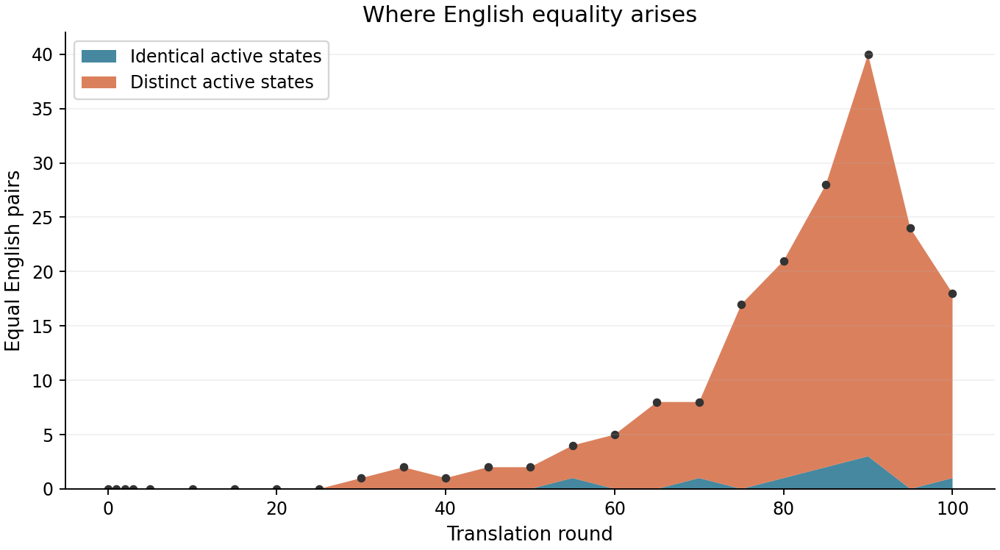

*Figure 9. English-equal pairs split into identical and distinct pre-observation states. This is an operational partition, not a causal estimate of diagnostic translation effects.*


## 7. Semantic evolution

The model is [all-MiniLM-L6-v2](https://huggingface.co/sentence-transformers/all-MiniLM-L6-v2), pinned to `1110a243fdf4706b3f48f1d95db1a4f5529b4d41`. It produces L2-normalized 384-dimensional embeddings; similarities are cosine inner products. We used Sentence Transformers 5.2.0, batch size 64, four CPU threads and a 256-wordpiece input limit. Model weights and embeddings are cached with configuration/content fingerprints. There are 21,012 unique original/observed texts; 22 unique texts exceed the embedding input limit. [Model provenance](semantic_status.json) records file hashes and package versions. The model card describes a sentence/short-paragraph encoder, not a truth or translation-fidelity evaluator.

Mean original-output cosine falls from 1.000000 to 0.126556; the final median is 0.086301. The final mean's trajectory-bootstrap sensitivity interval is [0.116132, 0.135371]. These intervals resample entire trajectories, preserving repeated measures; they do not estimate uncertainty across corpora, models or independent runs. Quantile bands show substantial variation among trajectories. [Semantic round metrics](tables/semantic_round_metrics.csv) and [trajectory metrics](tables/semantic_trajectory_metrics.csv).

The mean cosine between distinct current trajectories rises from 0.035345 to 0.101863, an increase of 0.066518. The all-pair mean is computed exactly using the norm of the vector sum; quantiles use a fixed seeded sample of 50,000 of the 499,500 unordered pairs. The sample is identical at all observations. The final sampled median is 0.090087. Similarity to the original and similarity across the current population answer different questions: severe drift can coexist with low between-trajectory similarity.

Embedding dispersion decreases from 0.963691 to 0.897239; covariance participation ratio changes from 113.490 to 100.746, while it initially rises rather than falling monotonically. Unit-vector dispersion and mean pair similarity are algebraically related; they must not be counted as independent confirmations. Neither the effective rank nor participation ratio measures the dimension of meaning.

At round 100, similarity-graph largest components contain 8, 5, 3 trajectories for cosine thresholds 0.7, 0.8, 0.9 respectively. There is no giant component at these choices. Connectivity is threshold-dependent and can join dissimilar endpoints through chains. It is not semantic equivalence. [Graph sensitivity](tables/semantic_graph_metrics.csv).

The lexical baseline provides a useful counterpoint. TF-IDF similarity to each original falls from 1.000000 to 0.046521; however, TF-IDF mean cross-trajectory similarity changes from 0.023096 to 0.022536, **not a net increase**. Thus drift is supported by both proxies, while population concentration is representation-dependent. The TF-IDF vocabulary and IDF weights are fitted once to all distinct original/observed texts for a fixed coordinate system; this is a descriptive retrospective baseline, not a predictive evaluation. [TF-IDF metrics](tables/tfidf_round_metrics.csv).


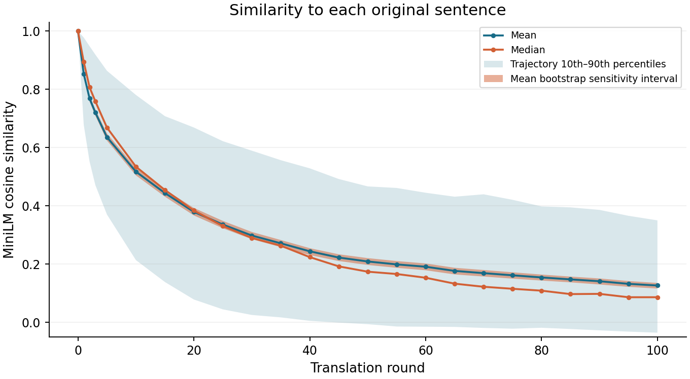

*Figure 12. Normalized MiniLM cosine to the corresponding original. Whole trajectories are resampled with the same 500 draws across rounds; bootstrap intervals describe corpus sensitivity, not uncertainty across models or independent experiments.*

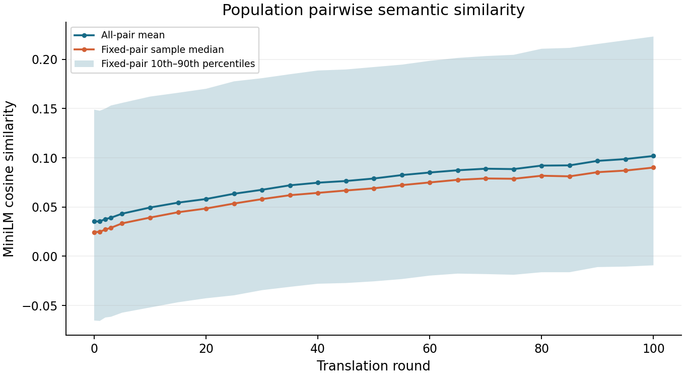

*Figure 13. Pair-similarity summaries use the same 50,000 sampled distinct trajectory pairs at every observation. The mean is also calculated exactly over all pairs; pair quantiles are descriptive and not independent replicates.*

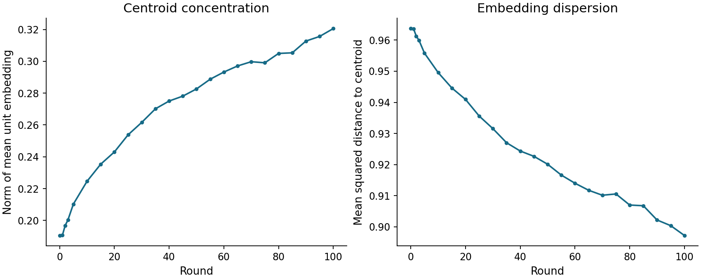

*Figure 14. For unit vectors, dispersion equals one minus squared centroid norm. These are related geometric descriptions, not independent evidence of semantic convergence.*

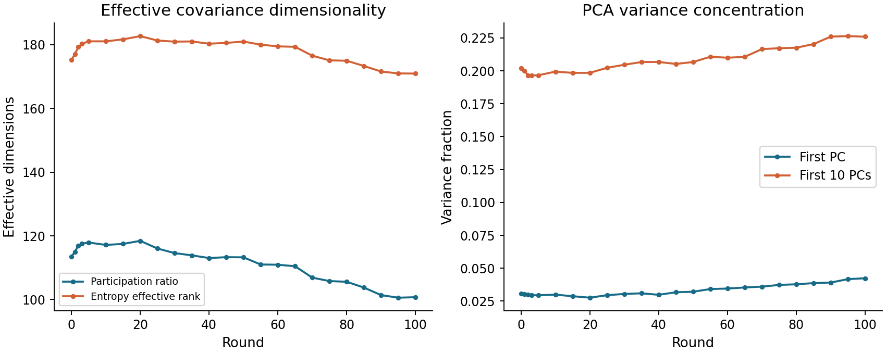

*Figure 15. Eigenvalues of centered embedding covariance determine participation ratio, effective rank and PCA variance shares. These are finite-sample properties of this embedding model, not dimensions of language.*

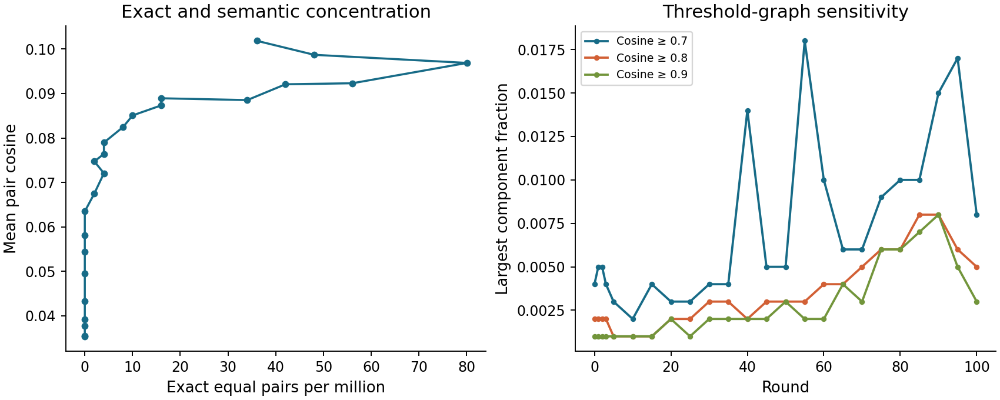

*Figure 16. Exact collision rates compared with semantic similarity, and largest similarity-graph components at three thresholds. Graph connectivity can chain dissimilar sentences and is not an equivalence relation on meaning.*


## 8. Information and content degradation

English word tokens use Unicode letter/digit runs with internal apostrophes, case-folded for lexical comparisons. A separate regex-token count includes punctuation; archived NLLB output token counts are also summarized, with no invented baseline NLLB count. We measure set-based word Jaccard, content-word retention using scikit-learn's fixed English stop list, number-marker retention, date-marker retention and negation-marker retention. These are proxies for surface preservation, not channel capacity or truth.

Mean word count changes from 21.886 to 14.984, but the median falls from 21 to 5. The final mean ratio to each original is 0.722; long repetitive outputs help explain why the mean remains far above the median. Population vocabulary decreases from 5,649 to 1,254 case-folded types. Mean original-word Jaccard reaches 0.0408, and mean content-word retention reaches 0.0239. Type-token ratios depend on length and cannot independently measure richness. [Lexical round metrics](tables/lexical_round_metrics.csv).

Numeric matching canonicalizes decimal tokens and comma thousands separators; it does not understand spelled-out numbers, units, date order or language-dependent numeric notation. Its final mean retention is 18.112% among 173 originals with numeric markers. Date matching uses English month names and years 1500–2099, so words such as “may” can be false positives. Negation matching is lexical and cannot resolve scope. Original sentences without the relevant marker are excluded from that retention denominator rather than scored as perfect preservation. No named-entity model was applied; preserving a name in the examples is direct textual evidence, not an entity-recognition score.

The best final original-cosine case still changes a date: the original says George W. Bush arrived in Singapore on November 16; the final observation says November 13. High embedding similarity therefore does not guarantee factual fidelity. Conversely, paraphrase can lower literal overlap without changing all meaning. [Case studies](examples/trajectory_case_studies.md).


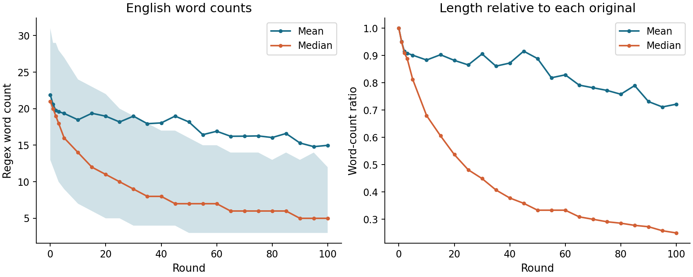

*Figure 17. Word counts and length ratios; shaded region gives trajectory 10th–90th percentiles. Repeated outputs can increase lengths, so shortening is not presumed.*

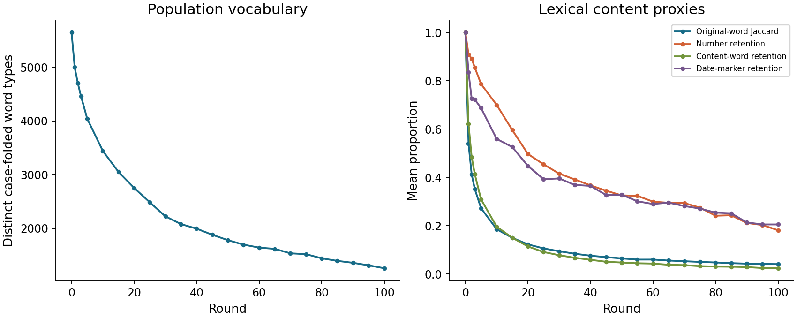

*Figure 18. Vocabulary and approximate content retention. Number/date averages include only originals containing those markers; dates use English month names and years, and content words exclude a fixed stop list.*

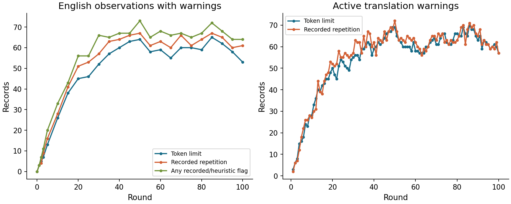

*Figure 19. Recorded warnings and separately defined heuristic flags. Warning sets overlap. The collector accepted these outputs with status ok; they are not retrospectively relabeled as explicit failures.*


## 9. Language-path effects

Every target language appears exactly 2,000 times in the main active transitions, once per trajectory in each permutation block. Source distributions include initial English and omit the last target as a subsequent source. We tabulate all observed ordered source-target transitions, per-round target counts, denominators and unique contributing trajectories. Rare transition cells remain descriptive. [Language statistics](tables/language_statistics.csv), [transition counts](tables/language_transitions.csv), [round usage](tables/language_usage_by_round.csv).

The highest combined flag rate is 9.50%. This quantity mixes recorded decoding warnings and separate heuristics. In particular, character-collapse flags can reflect script compactness: Chinese and Japanese naturally use fewer characters than many alphabetic inputs. These numbers must not be interpreted as language-quality rankings. Recorded repetition and generation-limit rates are reported separately.

At observation endpoints we relate original cosine and previous-observation cosine to the current language, after subtracting that observation round's population mean. A second table assigns round-centered original-cosine changes to languages encountered in the preceding interval; a multi-step interval's change is associated with all its languages and is not attributed causally to one. The dependence among interval exposures is retained conceptually, with no mass significance testing. [Endpoint associations](tables/language_semantic_associations.csv) and [interval associations](tables/language_interval_associations.csv), when embeddings are available.

Round 50/51 marks the second permutation. The adjacent flag rates show no conspicuous discontinuity by themselves; a single boundary cannot identify a boundary effect. Initial length, presence of numeric markers, initial lexical variety and punctuation are related descriptively to final original-cosine scores. These small associations do not establish causes or semantic topics. Language-family classifications and automatic topic labels were intentionally omitted rather than invented. [Boundary diagnostics](tables/permutation_boundary_metrics.csv), [original-property associations](tables/original_property_associations.csv).


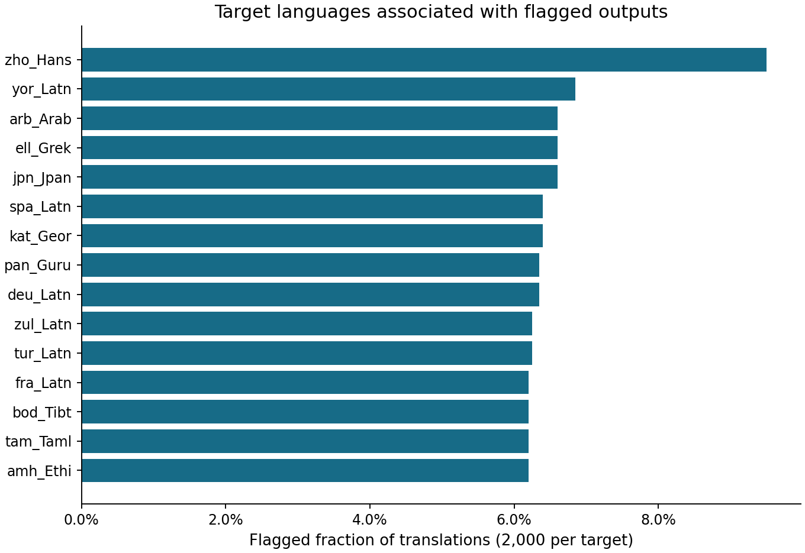

*Figure 20. The 15 target languages with highest descriptive flag rates. Input histories and scripts differ, and this is not a causal ranking of language quality.*


## 10. Candidate attractors and recurrence

We screen every English string ever shared by at least two trajectories, reporting its first/last appearance, maximum/final frequency, number of contributing originals, preceding languages, same-text pair persistence and complete frequency history. This is an operational candidate list, not inferred dynamics of an attractor.

The largest candidate is the long repeated “No, no, …” output, ID `6aea4625f7157c95a17c`. It first appears as a singleton at round 20, peaks at 8 members, and ends at 3. It is tagged for repetition and generation-token-limit saturation. At the peak-collision observation, 35 of 40 equal pairs involve flagged observations. The decoder's finite output limit may help make repetitive loops yield identical strings; the present data do not isolate this mechanism experimentally.

Other small recurring outputs include “This is very important.” and “- I saw it.” They are not automatically classified as failures. A generic-looking output may be grammatical while losing the original's specifics. Shared outputs draw from different source sentences, but we do not infer broad topic coverage without topic labels. Many trajectories also revisit their own English outputs without joining another trajectory; [self-recurrence statistics](tables/trajectory_self_recurrence.csv) keep that separate from population coalescence. [Candidate table](tables/candidate_attractors.csv) and [histories](tables/candidate_frequencies.csv).


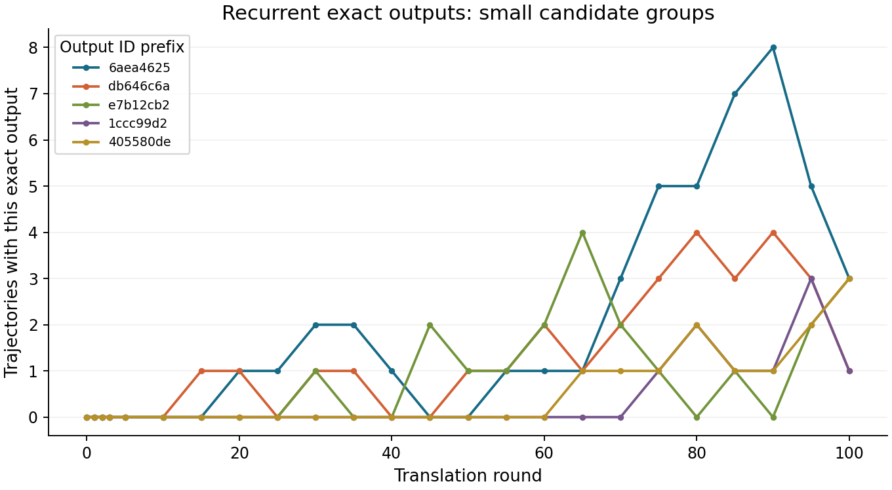

*Figure 21. Frequency histories for the five outputs with highest peak membership, tied by total contributing trajectories. Exact texts and membership evidence are in candidate_attractors.csv; none is asserted to be an attractor.*


## 11. Qualitative examples

The [case-study document](examples/trajectory_case_studies.md) and [full JSON](examples/trajectory_case_studies.json) show originals, actual observed intermediate English texts, warning flags and full language paths. Cases were selected by explicit extrema and group-membership rules, so they illustrate mechanisms rather than estimate prevalence. Long texts are explicitly excerpted in Markdown; the JSON retains them verbatim.

One original about Gosling and Stone receiving acting nominations ends as “Grace and her husband wrote a letter.” Another, about re-entry culture shock, enters the small group “This is very important.” A trajectory from an original about patience for returning travellers joins the peak “No” repetition group but ends with repeated “existence”; leaving an exact group need not mean recovering content. The strongest final embedding-retention example preserves a named person and place while changing the date. Together these cases show why exact diversity, semantic drift, factual error, repetition and group persistence need separate measurements.

## 12. Robustness and sensitivity

The primary sample includes every collector-accepted nonempty English output. There are no explicit failed outputs, so excluding recorded failures is numerically identical to the primary analysis. The stricter sensitivity filter excludes any recorded warning or independently defined heuristic flag: repeated-word fraction, dominant trigram repetition, Unicode replacement characters, more than 1,000 characters, or an abrupt character-count collapse from an input of at least 40 characters. These thresholds are declared in code and flag suspicious text without claiming to diagnose its meaning.

At round 100 this filter retains 936 trajectories, with 923 exact outputs and 15 equal pairs. The largest group remains 3. Thus the final lack of a dominant exact sentence is robust, while early and peak collisions are more sensitive to repetitive outputs. Excluding the single largest exact group at each round gives another sensitivity calculation; ties are broken lexically, and this exclusion does not necessarily target the same sentence over time. [Robustness metrics](tables/robustness_metrics.csv).

For embeddings, exclusion of flagged outputs, the largest output, or embedding-truncated texts preserves severe original drift and modest cross-population concentration. The TF-IDF disagreement about population concentration limits how strongly we can generalize the MiniLM result. Similarity-graph thresholds 0.70, 0.80 and 0.90 give different partitions, none approaching a single group. [Semantic robustness](tables/semantic_robustness.csv), when available.

We also draw 100 fixed seeded subsets of 500 trajectory IDs, using each subset throughout time. This is a descriptive stability check; smaller samples naturally lose rare collisions and tend to have a larger distinct fraction. We do not bootstrap distinct counts as if resampling duplicates gave an unbiased population-diversity estimate. Semantic bootstrap intervals resample full trajectories with replacement and are reported only as sensitivity summaries. No pairwise pseudo-replication or asymptotic extrapolation is used.


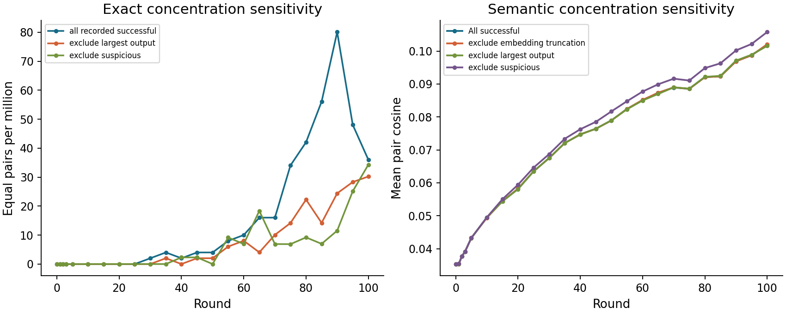

*Figure 22. Primary metrics alongside flagged-output and largest-group exclusions. Filtering changes the population and is a sensitivity analysis, not a correction to the observed experiment.*


## 13. Discussion

The central separation is between **loss of resemblance to the original** and **collapse of the population into a common output**. Strong changes in original-word overlap, numeric markers and original embedding similarity coincide with a population that remains mostly textually distinct. High empirical output-label entropy therefore does not imply good preservation of the original message. Conversely, small changes in label entropy cannot quantify how much original information was retained.

A second separation concerns observed equality and actual-state equality. Most English collisions occur between different active states. Equality at the observer is a many-to-one measurement event, often involving different languages, and cannot alone establish synchronization of the underlying chains.

A third separation concerns recurrence and absorption. Some equal pairs retain membership more than independent reassignment predicts, yet splits, re-collisions and declining late cluster sizes remain visible. The observed growth of small collision groups is not monotone coalescence. A graph of permanently merged trajectories would misrepresent these data.

Finally, decoding degeneracy matters without explaining everything. Saturated repetition accounts for much of the largest observed exact group, but filtered outputs still drift and remain diverse. Modest semantic concentration may reflect increasing genericity, model preferences or other factors; the archive does not distinguish these mechanisms. The contrary TF-IDF population trend is an explicit limit on a model-independent “semantic convergence” claim.

## 14. Implications for future mathematical research

### Observation maps and false state identification

**Observation:** 172/181 equal English pair-observations arise from different active states. **Possible framework:** a language-indexed state space with a many-to-one observation map into English. **Open question:** under what conditions can coalescence of observations identify coalescence, or bounded distance, in the latent linguistic states? **Needed:** a definition of state equivalence, observer-error assumptions and multiple independent observation maps or human annotations of paired states. This experiment supplies a counterexample to treating equality of observations as sufficient evidence of exact state equality, not a theorem about all observation maps.

### Independent versus shared random operators

**Observation:** English-equal pairs sometimes split and later meet again. **Possible framework:** random compositions indexed by language choices, with different operator sequences for each trajectory. **Open question:** how does equality persistence change when trajectories share future language choices instead of evolving independently? **Needed:** controlled shared-path and independent-path experiments from matched active states, explicit deterministic/stochastic transition definitions, and treatment of decoding constraints. Exact equality need not be absorbing under different next operators; common-noise synchronization and independent-noise coalescence are distinct questions.

### Memory without absorbing collision classes

**Observation:** endpoint persistence exceeds conditional group-size reassignment in several intervals, but all observed groups are small. **Possible framework:** recurrent or metastable regions and nonabsorbing membership dynamics. **Open question:** can a reduced process on reproducible text/semantic classes capture residence times and re-entry rates without assuming equality defines an equivalence class of future behavior? **Needed:** denser observations, more independent schedules per original, a validated coarse state definition and tests of whether a Markov approximation is adequate. Here the schedule has without-replacement memory inside each permutation; a text-and-language state alone need not be Markov unless the remaining schedule information is included.

### Content contraction with persistent label diversity

**Observation:** original-content proxies decline far more strongly than exact output diversity. **Possible framework:** contractions in selected semantic features alongside proliferation or preservation of surface distinctions. **Open question:** which well-defined observables contract, which persist, and does their behavior differ under alternative models or corpora? **Needed:** repeated conditional samples, externally validated content features, alternative embeddings and human factual scoring. The near-maximal output-label entropy does not estimate a mutual-information lower bound here, and embedding geometry cannot establish information contraction by itself.

These directions are motivated hypotheses and experimental designs. No fixed point, invariant measure, limiting distribution, universal attractor or infinite-time convergence result follows from this finite archive.

## 15. Limitations

This is one translation model, one fixed corpus, one main run and 100 rounds. The randomized schedules are structured permutations, not independent language draws at each step. Different originals have different realized paths; separating sentence susceptibility from path effects requires repeated schedules per original. Diagnostic English adds a model-dependent observation operation and is sparse after early rounds. Generation limits and repetitive outputs influence results. There is no independent multilingual language-ID, human quality or factual-consistency audit. Embeddings and lexical proxies are imperfect, and semantic grouping is threshold-dependent. Distributional concentration, exact state equality and pathwise synchronization remain distinct. Cross-language character/token statistics reflect script and tokenizer differences. No causal language ranking or asymptotic inference is warranted.

## 16. Conclusion

Universal exact convergence was **not observed**. Partial exact equality appeared only in small groups, with a maximum of 8/1,000 trajectories and a final distinct count of 985. The observed process exhibits content drift, small recurrent and transient collision groups, and persistent diversity. MiniLM suggests modest population concentration; lexical TF-IDF does not show the same net concentration, and neither measurement establishes semantic identity or long-term convergence. This is a useful negative result for the simple finite-round universal-collapse story, while the infinite-time conjecture remains unresolved.

## 17. Reproducibility

From the repository root:

```bash
bash analyze_local.sh
```

The script verifies the immutable archive, establishes a separate environment, uses four CPU threads, reconstructs/audits records, runs all analyses, reuses cached MiniLM embeddings, and generates this report. No translation model, API or GPU is used. A complete semantic cache avoids model inference on reruns. `bash analyze_local.sh --skip-semantic` runs the non-embedding analyses with TF-IDF; the semantic stage is explicitly marked skipped. `--stage audit|exact|temporal|content|semantic|language|robustness|figures|report` selects one stage; figures/report require their prerequisite tables. `--refresh-audit` forces full reconstruction. [Configuration](../../config/analysis.toml), [analysis README](../../analysis/README.md), [source/package provenance](analysis_provenance.json), [execution resource record](last_execution.json), and [output checksums](output_manifest.json).

Run tests with `.analysis_runtime/venv/bin/python -m unittest discover -s tests -v`. Synthetic cases cover unique outputs, universal equality, temporary collisions, stable partitions, projection effects, invalid outputs, missing IDs, sparse observations, permutation behavior, embedding geometry and archive loading. [Validation record](validation.md) records executed checks. The code version is defined by individual SHA-256 values in provenance, including uncommitted analysis files; a Git commit alone would omit these working-tree additions.

The original archive remains at `data/multilingual_translation_v1_complete.zip`; no extraction is needed. Derived tables are under `reports/translation_v1/tables`, figures have PNG and vector PDF versions, and long examples are separate. See [publication guide](../../PUBLICATION.md) for repository contents, raw-data sharing and attribution. The [MiniLM model card](https://huggingface.co/sentence-transformers/all-MiniLM-L6-v2) and [Sentence Transformers similarity documentation](https://sbert.net/docs/sentence_transformer/usage/semantic_textual_similarity.html) describe the embedding representation and cosine comparison used here.
